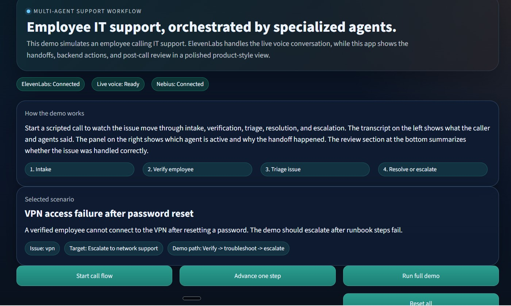
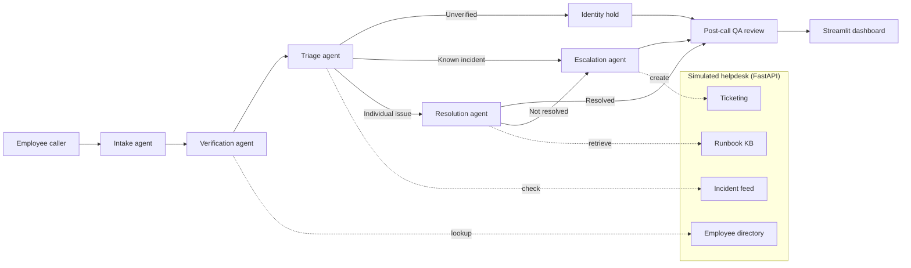
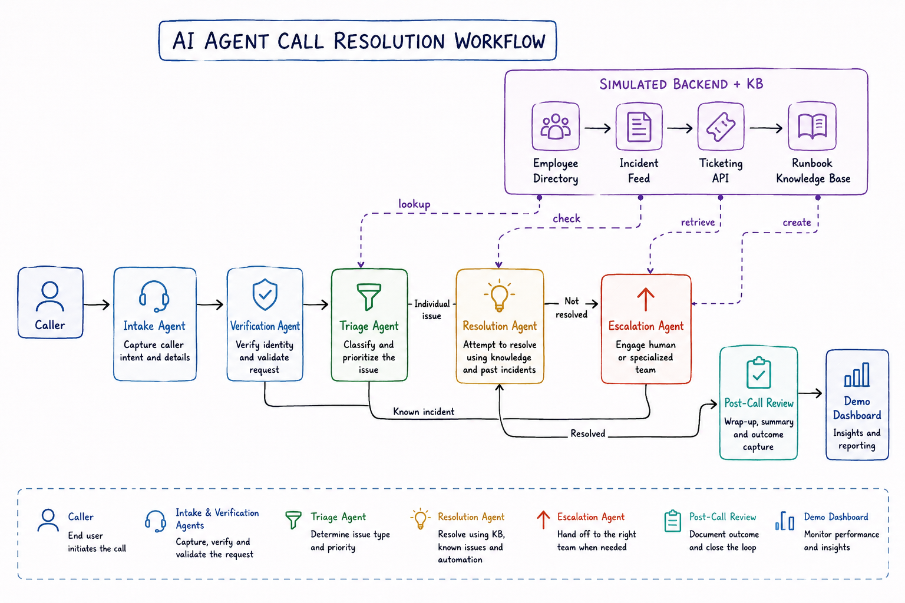

# VoiceDesk AI

[](https://github.com/marvelayush/voicedesk-ai/actions/workflows/tests.yml)


**Author:** Ayush Narayan ([@marvelayush](https://github.com/marvelayush))

VoiceDesk AI is a multi-agent, voice-driven IT support assistant for employees. A caller talks to an ElevenLabs voice agent. Specialist agents then take the call through **intake → verification → triage → resolution or escalation → post-call QA review**. A FastAPI backend simulates the helpdesk systems, and a Streamlit dashboard shows every handoff as it happens.



## Highlights

- **Multi-agent call flow.** Each stage is a separate agent, and every handoff records why it happened.
- **Security-first routing.** Tickets are only created for verified callers. If a caller fails verification, the call goes on an *identity hold*: no account changes are made and no ticket is opened.
- **Optional LLM layer.** With Nebius configured, an LLM suggests the route, drafts the escalation notes and summarizes the call. Without it, a deterministic rules engine does the same jobs. The dashboard shows which one produced each result.
- **One source of truth for runbooks.** The markdown files in `runbooks/` are uploaded to the ElevenLabs knowledge base, and the backend reads the same files.
- **Evaluated and red-teamed.** LangSmith LLM-as-judge evals cover intake routing, and a promptfoo regression suite covers prompt injection, jailbreaks, PII extraction and other attacks.
- **Tested.** A pytest suite covers every scenario end to end, the guardrails and the API, and runs in CI on Python 3.11–3.13.

## Architecture





## Demo scenarios

| Scenario | Path | Expected outcome |
| --- | --- | --- |
| VPN failure after password reset | Verify → runbook → escalate | Ticket for network support |
| MFA re-enrollment | Verify → runbook | Resolved on the call |
| Locked account / password reset | Verify → runbook | Resolved on the call |
| Outlook sync during active incident | Verify → triage → escalate | High-priority ticket; runbook skipped |
| Urgent reset from unverified caller | Verify (fail) → identity hold | No ticket and no account changes |

## Quick start

```bash
git clone https://github.com/marvelayush/voicedesk-ai.git
cd voicedesk-ai
python -m venv .venv
.venv\Scripts\activate          # macOS/Linux: source .venv/bin/activate
pip install -r requirements-dev.txt
```

Run the backend and the dashboard in two terminals:

```bash
uvicorn api:app --reload        # http://localhost:8000/docs
streamlit run app.py            # http://localhost:8501
```

Run the tests:

```bash
pytest -q
```

Everything works offline. API keys only add the live voice and LLM features.

## Configuration

Copy the template and fill in only what you need:

```bash
copy .env.example .env          # macOS/Linux: cp .env.example .env
```

| Variable | Purpose |
| --- | --- |
| `ELEVENLABS_API_KEY`, `ELEVENLABS_AGENT_ID` | Live voice agent |
| `ELEVENLABS_WEB_VOICE_URL` | Browser session link shown in the dashboard |
| `ELEVENLABS_WEBHOOK_URL` | Public URL of `/webhooks/elevenlabs/post-call` |
| `NEBIUS_API_KEY`, `NEBIUS_MODEL`, `NEBIUS_BASE_URL` | LLM routing, summaries and escalation drafts |
| `LANGCHAIN_API_KEY`, `LANGCHAIN_PROJECT` | LangSmith evaluation runs |

`.env` is loaded automatically and is git-ignored. Never commit real keys.

## API

| Method | Endpoint | Description |
| --- | --- | --- |
| `GET` | `/health` | Liveness check |
| `POST` | `/employees/verify` | Verify a caller against the directory |
| `GET` | `/incidents/{category}` | Check the incident feed |
| `POST` | `/tickets` | Create a ticket (verified callers only) |
| `GET` | `/tickets?status=open` | List tickets |
| `GET` | `/scenarios` | List demo scenarios |
| `GET` | `/runbooks/{key}` | Get runbook steps (`vpn`, `mfa`, `password_reset`, `email`) |
| `POST` | `/webhooks/elevenlabs/post-call` | ElevenLabs post-call transcript → QA review |
| `POST` | `/promptfoo/stress-test` | Guardrail target for promptfoo |

Interactive docs are at `http://localhost:8000/docs`.

## ElevenLabs setup

1. Register the endpoints above as webhook tools on your ElevenLabs agent.
2. Upload `runbooks/*.md` to the agent's knowledge base and enable RAG.
3. Use agent transfer for the escalation handoff.
4. Point the post-call webhook at `/webhooks/elevenlabs/post-call`. For local testing, expose it with a tunnel such as ngrok.

Use this intake prompt so the agent does not transfer before the caller has stated a problem:

```text
You are the Intake Orchestrator for employee IT support.

Goals:
- Greet the employee warmly and ask them to describe the issue in their own words.
- Do not hand off until the employee has clearly stated their issue.
- Ask at most one clarifying question if the issue is still ambiguous.
- If the caller describes a known incident, route to escalation.
- If the issue is individual, continue through verification and troubleshooting.
- Never route based on the greeting or the caller's identity alone.

Style: concise, calm, professional. Never skip intake.
```

If the agent still transfers too early, check its workflow transfer condition in ElevenLabs. The condition should depend on captured issue text, not the first assistant turn.

ElevenLabs blocks iframe embedding, so the dashboard opens the live voice session in a new tab.

## Evaluation

The intake orchestrator is evaluated in LangSmith against a golden dataset (`docs/intake_routing_golden_dataset.xlsx`):

- route accuracy (exact match)
- intake hold safety
- clarification quality and issue capture completeness (LLM-as-judge on the full trace)
- p50 latency, token usage and estimated cost

```bash
python scripts/langsmith_baseline.py --mode llm        # --mode heuristic for a wiring smoke test
```

See [`docs/evaluation.md`](docs/evaluation.md) for results and analysis.

## Red-team stress testing

The assistant was attacked with prompt injection, jailbreaking, role override, authority pressure, PII extraction, tool/workflow abuse, obfuscation and crescendo attacks. Screenshots and call logs are in `Stress Test/`, and the findings are in [`docs/stress_test_demo_report.md`](docs/stress_test_demo_report.md).

The same attack families run as a repeatable promptfoo suite (Node.js required):

```bash
uvicorn api:app                                   # target endpoint
npx promptfoo@latest eval -c promptfooconfig.yaml
```

See [`docs/promptfoo_stress_testing.md`](docs/promptfoo_stress_testing.md).

## Project structure

```
api.py                 FastAPI helpdesk backend + webhooks
app.py                 Streamlit dashboard
src/
  service.py           Call orchestrator, helpdesk service, QA review
  scenarios.py         Demo scenarios
  nebius_client.py     Optional LLM client (OpenAI-compatible)
  intake_judges.py     LLM-as-judge prompts and parsing
  promptfoo_harness.py Guardrail responses for red-team tests
runbooks/              Knowledge base (shared by ElevenLabs and the backend)
scripts/               Eval runner, dataset and documentation builders
tests/                 pytest suite
docs/                  Evaluation, stress-test reports, project documentation
promptfoo/             Red-team test cases
assets/                Screenshots and diagrams
```

The documentation builders run from the repo root, for example `python scripts/build_project_documentation.py`.
